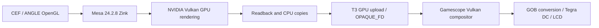

# Steam UI on Zink: measured 480p baseline, 13 October 2026

Implementation/build commands in this document belong to the sibling
[gamescope-tegra repository](https://github.com/zodiakborodin98/gamescope-tegra).

The development Switch now runs **854x480 Steam GamepadUI on Zink/NVIDIA**.
Both native Steam's OpenGL browser composer and multiprocess CEF use private
Mesa 24.2.8/Zink on Tegra X1 (Vulkan 1.2.131, L4T 32.7.4), rather than llvmpipe.
The user navigated the UI and confirmed geometry, orientation and content.
240p,540p and720p variants also received physical-screen confirmations.
This remains a slow, unstable research system, not an everyday SteamOS release.

## Actual route



Steam selects `-composer-mode=2` (CBrowserComposerGL). CEF uses ANGLE's GL
backend and `--no-zygote` multiprocess execution. It is neither the old
`-system-composer` path nor a single-process CEF workaround.

T3 intercepts the private Mesa GLX/drisw presentation path for real X11
drawables. It renders to ordinary Zink resources and transfers real pixels
through GPU readback/CPU staging and the accepted OPAQUE_FD buffer protocol.
It avoids the unavailable NVIDIA X11 WSI/GBM/DRI3 client presentation contract;
it does not fabricate visuals, extensions, device identity or VkResult values.
CPU OSR/OnPaint, pixel copies and synchronization remain. **This is not zero-copy.**

The compositor and game output remain independent of the UI resolution:
logical1280x720, portrait scan720x1280/stretch, UI854x480 via Xwayland override.
The CPU library/deploy is retained on the device only as a rollback route.

## Repairs that made the route work

1. Early native ICD initialization: at fresh Steam/CEF exec, before application
   threads, hide DISPLAY for real NVIDIA ICD load/create/enumerate, then restore
   it. L4T's DISPLAY-conditioned GLX path otherwise enumerates no devices under
   this Xwayland. The shim retains the real initialized ICD context; it does not
   substitute an emulator GPU or redirect UI to llvmpipe.
2. Exact private CEF request adjustment: GL 4.3/GLSL 430 to the actual supported
   GL 4.2/GLSL 420. The driver does not pretend to offer GL 4.3. Only an exact
   user-supplied ARM64 binary revision is accepted by the local patch helper.
3. Texture-from-pixmap: an opt-in real XImage readback/upload path for CEF
   pixmaps replaces the unavailable DRI3 import; null-error handling is fixed.
4. CEF child-window contents: XCB image upload reaches the actual toplevel
   framebuffer/T3 producer instead of a composed but stale/empty parent image.
5. Depth/stencil blit: a real image barrier precedes a legacy renderpass that
   reads a previously writable attachment (layout3 to4); capabilities are unchanged.
6. T3 resize: ordinary immutable VkImages are recreated with the new extents;
   merely changing pipe_resource dimensions was incorrect and caused a real
   native resize MMU/PTE fault. The isolated fixed GPU reproducer passed full
   scans of1,024,000+102,240 pixels with no mismatches and clean cleanup.
7. Dedicated allocation guard is retained in the measured profile; it is not
   a claim that suballocation alone caused the historical fault.

The private Steam/CEF sources, driver binaries, raw logs and core dumps are not
published. The open Mesa changes, bootstrap source, source pins and portable
build recipes are published in `graphics-stack/`.

## Rebuild the open components

```sh
python3 scripts/fetch_graphics.py mesa-zink-t3
python3 scripts/build_graphics.py mesa-zink-t3 \
  --source _work/graphics-sources/mesa-zink-t3 --sysroot /path/to/aarch64-sysroot \
  --host-tools _work/host-tools --build-dir _work/build-zink-t3 --jobs 2
python3 graphics-stack/steam-zink/build-bootstrap.py \
  --sysroot /path/to/aarch64-sysroot --output _work/libsteam-zink-forkexec.so
```

Mesa 24.2.8 release and patch SHA are pinned in `graphics-stack/sources.lock.json`;
all changed preferred-source hashes are in `graphics-stack/zink-t3-provenance.json`.
Mesa 26's separate source profile is not this working route. A fresh public build
is not guaranteed byte-identical to the historical build or hardware-qualified.
The historical compositor reconstruction remains separately identified in the
root lock; client Zink acceptance does not qualify a freshly rebuilt compositor.

`graphics-stack/steam-zink/prepare-local-cef.py` creates an exact private copy
from an already authorized local client and refuses unknown revisions/in-place
replacement. It downloads or publishes no Steam binary. Vendor terms remain
applicable. Service recipes are in the sibling `steamos-tegra` repository.

## Performance and CPU work

Matched 10Right/Left menu navigation measured completed T3 UI transfers:

| UI | Completed UI transfers/s |
|---|---:|
| 426x240 | 35.500 |
| 960x540 | 14.265 |
| 854x480 | 17.203 |

720p was about6.997/s across a different activity pattern; it is not a matched
navigation comparison. **Physical display FPS is not measured.** No Gamescope
present count is used as game/UI FPS.480p had363 samples,362 content changes,
zero missing generations over21.043s. Logs were in RAM at480p versus disk in
the240p/540p runs; resolution is not claimed as the sole performance variable.

Replacing llvmpipe removes CPU triangle/pixel rasterization, not the whole CPU
workload. CEF still runs JavaScript, layout, browser/renderer IPC and OSR work;
Mesa/Zink prepares Vulkan commands and shaders; T3 copies/maps/uploads pixels.
Integrated Tegra memory does not remove those synchronization and copy costs.
For an ordinary Linux top-style view,100% usually represents one saturated
logical CPU, not every CPU in the console. Exact CPU hotspot proportions have
not been profiled; the above costs must not be presented as measured percentages.

The qualified short tests used `ZINK_DEBUG=sync,flushsync,noreorder,nobgc` in CEF:
these insert barriers, force synchronous flushes and inhibit optimizations or
asynchronous compilation. After approximately an hour of user navigation
without noticed UI bugs, the user requested all optional diagnostics be disabled.
Those flags, trace variables and observer preload are now disabled in the
permanent480p profile; functional fixes/early ICD/layer isolation remain.
The service restarted active. **Post-change visual and performance verdicts are
pending user testing**; the diagnostic-mode17.203/s is not a new optimized FPS.

See the [Mesa Zink documentation](https://docs.mesa3d.org/drivers/zink.html)
for debug flag meanings and [CEF126 RenderHandler](https://cef-builds.spotifycdn.com/docs/126.2/classCefRenderHandler.html)
for the distinction between pixel-buffer OnPaint and accelerated shared-texture
delivery. These upstream interfaces do not prove Steam uses zero-copy here.

## Remaining limits

Cold boot/long soak/new-game compatibility of the new profile are not qualified.
Historical EGLStream startup/teardown and game consumer faults remain open in
their own routes. Successful Steam UI Zink rendering does not repair every
FEX/Box64 game or imply a finished image installer. Frequent session restarts
previously left orphan SHM segments; cleanup restored startup but no permanent
orphan-cleaner has been added.
